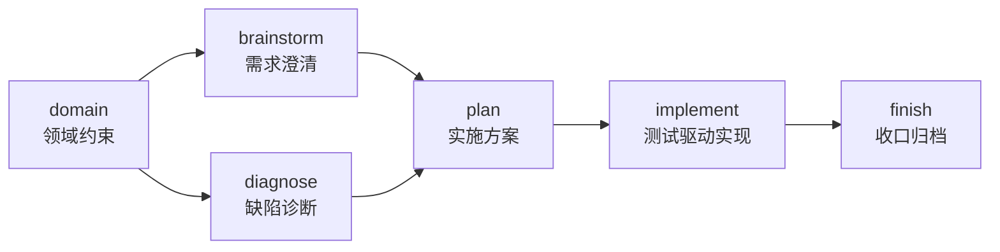

# omp-skills

<p align="center">
  <strong>面向 OMP 的可复用技能集</strong><br/>
  从 axiom 内置 SDD 工作流迁移、按 OMP 工具语义适配
</p>

<p align="center">
  <a href="https://github.com/can1357/oh-my-pi"></a>
  
  <a href="https://github.com/amuluze/omp-skills/stargazers"></a>
  <a href="https://github.com/amuluze/omp-skills/issues"></a>
</p>

---

## 这是什么

一组以 `SKILL.md` 为载体的技能包，覆盖一条完整的工程闭环：

**领域约束 → 需求澄清 / 缺陷诊断 → 实施方案 → 测试驱动实现 → 收口归档**

每个技能都可以单独使用；链式使用时，前一步的产出就是后一步的输入。



## 技能一览

| 技能 | 阶段 | 作用 | 主要产出 |
| :--- | :--- | :--- | :--- |
| [`domain`](./domain/SKILL.md) | 约束 | 把领域规则收敛成可判定的不变量，拒绝把实现偶然写成领域事实 | `.specs/domain/<topic>.md` |
| [`brainstorm`](./brainstorm/SKILL.md) | 澄清 | 三句话复述需求，一次只问一个最高价值问题，验收四问自检 | `.specs/tasks/<task-id>.md` |
| [`diagnose`](./diagnose/SKILL.md) | 诊断 | 在匹配表面复现，二分假设，无新信息即停；诊断期不改码、不提交 | 复现证据 + 修复 Task Spec |
| [`plan`](./plan/SKILL.md) | 设计 | 设计闸门先行；每条验收映射到证据类型与通过判据 | `.plans/<task-id>.md` |
| [`implement`](./implement/SKILL.md) | 实现 | RED→GREEN→重构；测试双检、真实表面验证、INCONCLUSIVE 出口 | 代码 + 测试 + 验证证据 |
| [`finish`](./finish/SKILL.md) | 收口 | 文档对齐、任务归档、五要素证据摘要、遗留项；**提交仅在明确要求时发生** | 收口摘要 + 可选提交 |
| [`greeting`](./greeting/SKILL.md) | 写作 | 按关系、场合、渠道校准问候语，拒绝模板化套话 | 2–3 个梯度版本 |

## 快速开始

### 方式一：全局安装（所有项目可用）

```bash
git clone https://github.com/amuluze/omp-skills.git
mkdir -p ~/.omp/agent/skills
cp -R omp-skills/{domain,brainstorm,diagnose,plan,implement,finish,greeting} ~/.omp/agent/skills/
omp skill list
```

### 方式二：项目级安装（只在该仓库可用）

```bash
mkdir -p .omp/skills
cp -R /path/to/omp-skills/{domain,brainstorm,diagnose,plan,implement,finish,greeting} .omp/skills/
```

### 方式三：挂载为自定义目录（不复制文件，随仓库更新）

克隆后在 `~/.omp/agent/config.yml` 或项目 `.omp/config.yml` 中：

```yaml
skills:
  customDirectories:
    - ~/src/omp-skills
```

> 仓库根目录即 `<skill>/SKILL.md` 布局，可直接作为 `customDirectories` 的值。
> 自定义目录中的技能优先级高于默认 provider 的同名技能。

## 使用

**自动触发**：安装后，模型根据技能描述判断是否调用。

**显式调用**：

```text
/skill:diagnose 登录接口偶发 401
/skill:plan 按 .specs/tasks/fix-login-timeout.md 出方案
/skill:greeting 给合作两年的供应商写春节祝福，微信发
```

**仅在需要时触发**（避免通用流程技能干扰普通请求），在对应 `SKILL.md` 的 frontmatter 加：

```yaml
disable-model-invocation: true
```

该技能会从系统提示词清单中隐藏，仍可通过 `/skill:<name>` 手动调用。

> 新安装的技能在**新会话**生效；当前会话的清单是启动时的快照。

## 目录结构

```text
omp-skills/
├── README.md
├── brainstorm/SKILL.md
├── diagnose/SKILL.md
├── domain/SKILL.md
├── finish/SKILL.md
├── greeting/SKILL.md
├── implement/SKILL.md
└── plan/SKILL.md
```

## 相对 axiom 原文的适配

| axiom 原文 | OMP 适配 |
| :--- | :--- |
| `inspect_subagent` / `examine_subagent` / `review_subagent` | `task`（`agent: reviewer`） |
| `<available_docs>` 注入索引 | 直接读取 `AGENTS.md`、`.docs/`、`.specs/` |
| 系统提示词的 Git 分支规则 + 默认 commit/push | 删除；提交改为仅在用户明确要求时执行，推送单独确认 |
| `test-authoring` / `tests/verify.md` 依赖 | 移除（绑定 Axiom 测试 runner，不适用于 OMP） |
| 「宿主审批约定」 | OMP 审批流程 |

**未收录的 axiom 内置技能**：`design`（依赖 `.ax` 格式、`design_query` 与设计画布）与 `test-authoring`（依赖 `axiom.test` 协议与确定性 runner）——两者都由 Axiom 宿主提供运行时，脱离后无法执行。

## 约定与兼容性

- 六个 SDD 技能默认使用 `.specs/`（Spec）与 `.plans/`（Plan）；项目不采用该约定时可忽略对应步骤，技能不会强制创建文件。
- 已在 OMP `18.16.0` 上验证：`omp skill list` 与 `skills.customDirectories` 两种发现路径均正常。
- 技能正文为中文；`name`/`description` 遵循 OMP frontmatter 要求（目录名与 `name` 一致，`description` 必填）。

## 贡献

发现某条规则在 OMP 下不成立，或想补充新的阶段技能：直接提 issue 或 PR。
新增技能请保持 `SKILL.md` 单文件、目录名与 `name` 一致，并在 PR 中说明触发场景与依赖工具。

## 来源

技能正文源自 [axiom](https://github.com/amuluze/axiom) 的内置 SDD 技能（`BUILTIN_SKILL_BODIES_VERSION` 43），按 OMP 18.16.0 的工具体系与运行语义适配；`greeting` 来自 axiom 项目级技能示例。
